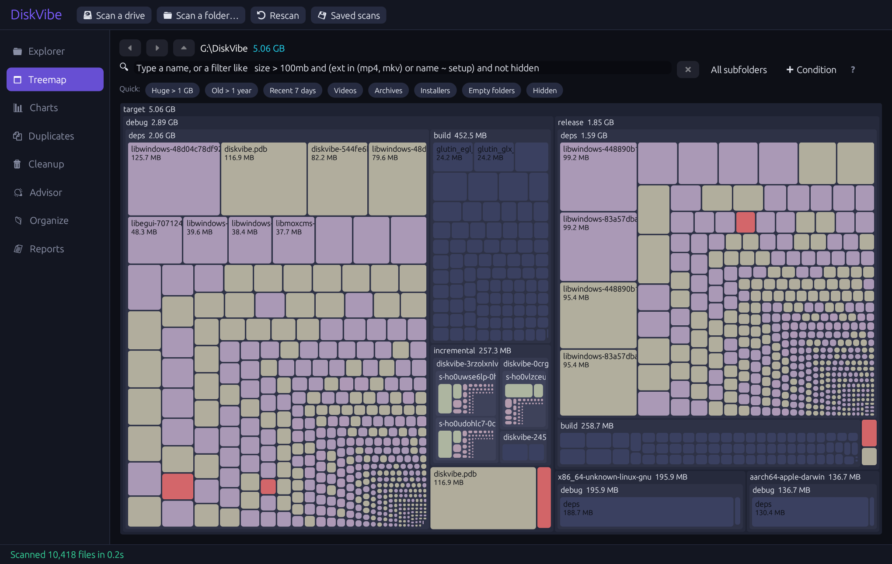
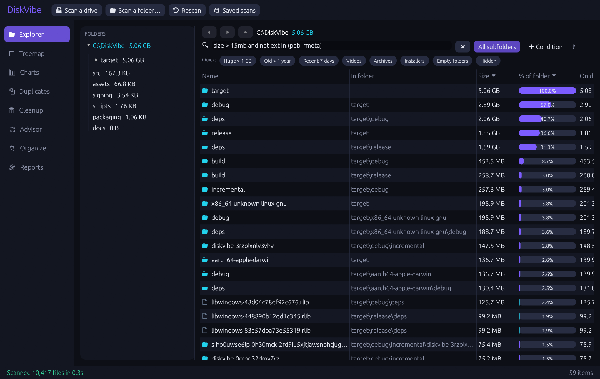
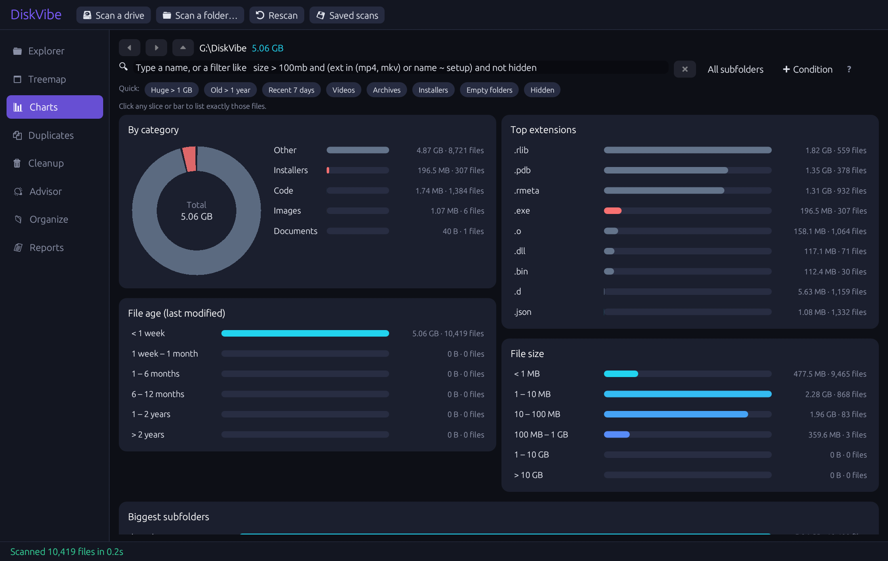

<div align="center">


# DiskVibe

**See where your disk space went — and get it back.**

A disk size inspector and cleaner with a real file explorer, one filter language for everything, and a command line and MCP server for your AI assistant. Pure Rust, for Windows, macOS and Linux.

[](#how-its-built)
[](#downloads)
[](#command-line-and-mcp-server)
[](#feature-status)
[](#releasing-a-new-version)

<a href="docs/screenshot-treemap.png"></a>

<sub><i>The treemap: every folder and file drawn in proportion to its size. Click a tile to zoom in.</i></sub>

[Explore](#a-file-explorer-that-knows-sizes) · [Filter](#one-filter-language-everywhere) · [Charts](#charts-you-can-click-through) · [Clean](#clean-up-more-than-the-obvious) · [Advisor](#an-advisor-not-just-a-list) · [Reports](#reports) · [CLI & MCP](#command-line-and-mcp-server) · [Downloads](#downloads) · [Build](#quick-start) · [Changelog](CHANGELOG.md)

</div>

---

## A file explorer that knows sizes

<a href="docs/screenshot-explorer.png"></a>

<sub><i>The Explorer with a filter applied across all subfolders: everything over 15 MB that isn't a debug file.</i></sub>

Scan a drive or a folder once, then move around it like you would in your file manager — except every folder already knows its total size.

- **Folder tree, breadcrumb, back / forward / up** — and Backspace and Alt+arrows work the way you expect.
- **Columns that matter** — size, share of the parent folder, size on disk, file and folder counts, modified / created / accessed dates, category and attributes.
- **Multi-column sort** — click a header to sort, Shift+click another to break ties.
- **Right-click anything** — open, show in your file manager, copy the path, or move it to the recycle bin (Delete works too).
- **Saved scans** — every scan is saved automatically. The latest one reopens when you start the app, and the *Saved scans* menu switches between them, so you only rescan when you want fresh numbers.
- **Fast** — the scanner uses every CPU core and never follows links, so nothing is counted twice.

## One filter language everywhere

Type a name to search, or a condition to filter. The same bar sits on the Explorer, Treemap, Charts and Duplicates tabs, and Reports use it too.

```
size > 100mb and (ext in (mp4, mkv) or name ~ setup) and not hidden
```

| You can use | |
|---|---|
| **Fields** | `name` `path` `ext` `type` `category` `size` `alloc` `files` `dirs` `depth` `modified` `created` `accessed` `age` |
| **Flags** | `file` `dir` `hidden` `readonly` `empty` |
| **Comparisons** | `=` `!=` `>` `>=` `<` `<=` · `~` contains · `!~` doesn't contain · `=~` regular expression · `in (a, b, c)` |
| **Logic** | `and` `or` `not` and parentheses. Two conditions side by side mean *and*. |
| **Values** | sizes like `500kb` `1.5gb` · dates like `2024-01-31` or `30d` `6mo` `1y` ago · `*` and `?` wildcards |

A few to try:

```
category = videos and age > 365          old videos
modified < 1y and size >= 1gb            big and untouched for a year
dir and empty                            empty folders
*.log or path =~ "cache|temp"            logs, and anything in a cache or temp path
```

Prefer clicking? **➕ Condition** builds a filter from drop-downs, and the quick chips (*Huge > 1 GB*, *Old > 1 year*, *Videos*, *Empty folders*…) add common ones in one click. Turn on **All subfolders** to search everything below the current folder.

## Charts you can click through

<a href="docs/screenshot-charts.png"></a>

<sub><i>Space by category, extension, file age and file size. Click any slice or bar to list exactly those files.</i></sub>

- **By category** — videos, audio, images, documents, archives, installers, disk images, code, fonts.
- **By extension, by age, by size** — find the 3 files that hold half the space, or the gigabytes nobody has opened in two years.
- **Biggest subfolders** — click one to go there.
- Every chart follows the current folder and the current filter.

## Clean up more than the obvious

Big files are easy. DiskVibe also finds the space you forgot about.

- **Duplicates** — files are matched by size, then by a BLAKE3 hash of their content, so a match is a real copy. Select everything except the newest, the oldest or the shortest path in one click, then recycle.
- **Caches and junk inside a scan** — `node_modules`, Python caches, Rust `target` folders, Unity `Library` folders, browser and app caches, crash dumps, unfinished downloads, `.bak` / `.old` leftovers and oversized logs, each with the reason it is safe to remove.
- **System temp locations** — measured and cleared in one click. Anything used in the last 24 hours or currently in use is left alone.
- **Recoverable by default** — everything goes to the recycle bin. Only temp clearing deletes permanently, and it asks first.

## An advisor, not just a list

- **Disk overview** — every disk with its type (SSD or hard disk), filesystem, free space and a quick speed test.
- **Move cold data off fast disks** — "*40 GB of videos in Downloads are clogging your SSD; disk J: is a hard disk with room and would work just fine for them.*" One button moves them: each file is copied, verified, then removed from the source.
- **Pagefile and hibernation** — tells you when the pagefile is larger than your memory needs, when it sits on a nearly full disk and where it would fit better, and how much the hibernation file costs. It explains what to change and where; it never changes system settings itself.
- **Organize a folder** — sort the loose files in a folder (Downloads, for instance) into *Videos*, *Images*, *Documents*, *Archives*, *Installers*… by type. You see the plan first and can undo afterwards. Subfolders and unknown file types are left alone.

## Reports

Fourteen sections, all optional: summary, largest files, largest folders, by category, by extension, by age, by size, old and large files, empty folders, caches and junk, folder tree, disks, suggestions and duplicates.

Export as **TXT, Markdown, HTML, CSV or JSON**. The HTML report is a single self-contained page with size bars.

## Command line and MCP server

The same executable is the app, a command-line tool and an [MCP](https://modelcontextprotocol.io) server. Every tool takes the same filters and sorting as the app.

```sh
diskvibe                       # open the app
diskvibe D:\                   # open the app and scan D:
diskvibe ls C:\Users --limit 20
diskvibe find D:\ --filter "category = videos and age > 365" --sort "size desc, name"
diskvibe dupes D:\Photos --min_size 5mb
diskvibe report C:\ --format html --out report.html
diskvibe --help                # every tool and the full filter syntax
```

| Tool | What it does |
|---|---|
| `ls` · `find` · `stats` | sizes of a folder's contents · deep filtered search · breakdown by category, extension, age and size |
| `dupes` · `junk` · `temp` | duplicate files · caches and leftovers · system temp locations (report, or clear) |
| `disks` · `advise` · `bench` | disk list · suggestions · disk speed test |
| `organize` · `trash` | sort a folder by file type (dry run unless `--apply`) · move paths to the recycle bin |
| `report` | the full report, any sections, any format |

Every tool also takes `--format txt|md|html|csv|json` and `--out <file>`.

**For AI assistants**, register the executable with the single argument `mcp`:

```json
{
  "mcpServers": {
    "diskvibe": { "command": "C:\\Tools\\DiskVibe.exe", "args": ["mcp"] }
  }
}
```

The assistant gets the same tools, with JSON output by default. Tools that change files are dry-run or recycle-bin based, and the server tells the assistant to confirm destructive steps with you first.

## Fast, native, yours

- One native executable per platform, about 8 MB. No installer needed, no runtime, no account, no network.
- Nothing leaves your computer. Scans are saved locally (on Windows under `%LOCALAPPDATA%\DiskVibe\scans`).
- Deletions go to the recycle bin; moves never overwrite an existing file.

## Feature status

| Area | Status |
|---|---|
| Parallel scanner, saved scans | ✅ |
| Explorer, folder tree, multi-column sort | ✅ |
| Filter language, condition builder | ✅ |
| Treemap, charts with click-through | ✅ |
| Duplicates (size + content hash) | ✅ |
| Cache / junk detection, temp clearing | ✅ |
| Advisor: disks, pagefile, hibernation, offload suggestions | ✅ Windows · 🚧 macOS / Linux (disks and offload only) |
| Organize a folder, with undo | ✅ |
| Reports in TXT · Markdown · HTML · CSV · JSON | ✅ |
| Command line, MCP server | ✅ |
| Windows build, self-signed | ✅ |
| macOS universal app, Linux AppImage | 🚧 built by the release workflow, not yet tested on real machines |
| Exact on-disk size for compressed / cloud-only files on Windows | ⬜ rounded to 4 KB clusters for now |
| Named, reusable filters | ⬜ |
| Publicly trusted signature, macOS notarisation | ⬜ |

✅ done · 🚧 in progress · ⬜ not yet

## Downloads

> **Get the latest version:** open **[Releases › Latest](../../releases/latest)** and pick your platform. Every release also has `SHA256SUMS.txt` for checking downloads.

### Windows

| Build | File | Notes |
|---|---|---|
| **Portable** | `DiskVibe-<version>-windows-x64.zip` | Unzip and run `DiskVibe.exe`. Nothing to install. |

The executable is signed by **Circuit Biscuit** with a self-signed certificate. That proves the file wasn't altered after it was built, but Windows doesn't know the certificate, so SmartScreen may still say *"Windows protected your PC"* — click **More info › Run anyway**. To make Windows show the publisher as trusted, install `DiskVibe-signing.cer` (included in the zip and in [`packaging/`](packaging)) into *Trusted Root Certification Authorities* and *Trusted Publishers* — only do that if you trust this repository.

### macOS

| Build | File | Notes |
|---|---|---|
| **Universal app** (Apple Silicon + Intel) | `DiskVibe-<version>-macos-universal.dmg` | Open, drag **DiskVibe** to **Applications**. |
| Command line | `DiskVibe-<version>-macos-universal-cli.tar.gz` | The bare `diskvibe` binary, for the terminal and MCP. |

The app isn't notarised yet: the first time, **right-click DiskVibe › Open › Open** (or *System Settings › Privacy & Security › Open Anyway*). Requires macOS 11+.

### Linux

| Build | File | Notes |
|---|---|---|
| **AppImage** (recommended) | `DiskVibe-<version>-linux-x86_64.AppImage` | `chmod +x` it and double-click. Runs on most distributions. |
| Tarball | `DiskVibe-<version>-linux-x86_64.tar.gz` | The bare `diskvibe` binary. |

## Quick start

Build from source with a recent stable Rust:

```sh
git clone https://github.com/Circuit-Biscuit/diskvibe
cd diskvibe
cargo run --release
```

On Linux install the windowing libraries first: `sudo apt install libxkbcommon-dev libwayland-dev libx11-dev libxcursor-dev libxrandr-dev libxi-dev libgtk-3-dev`.

Useful commands:

```sh
cargo test                                  # filter language and saved-scan tests
cargo run --release -- D:\                  # open the app on a folder
cargo run --release -- find . --filter "size > 10mb"
```

## How it's built

| Layer | Where | What |
|---|---|---|
| Scanner | `src/scan.rs` | parallel directory walk into a flat tree, file categories, saved scans |
| Filter and sort | `src/query.rs` | the filter language: lexer, parser, evaluation, multi-key sort |
| Operations | `src/ops.rs` | duplicates, junk detection, temp clearing, organize, disks, advice, speed test |
| Reports and tools | `src/api.rs` | report sections, the five output formats, the tools shared by the CLI and MCP |
| CLI and MCP | `src/main.rs` | argument handling and the MCP server (JSON-RPC over stdio) |
| App | `src/gui.rs` | every tab, the treemap and charts, dialogs |
| Packaging | `packaging/`, `scripts/`, `.github/workflows/` | signing, app bundles and automatic releases |

Pure Rust on [egui / eframe](https://github.com/emilk/egui), with rayon, BLAKE3, sysinfo, regex, chrono, trash and rfd.

## Releasing a new version

Releases are automatic. Bump `version` in `Cargo.toml`, add a `## [x.y.z]` section to [CHANGELOG.md](CHANGELOG.md) (it becomes the release notes) and push to `main`. The **Release** workflow notices the new version, builds the signed Windows zip, the macOS universal `.dmg` and the Linux AppImage, and publishes them as release `vx.y.z` with checksums. Pushes that don't change the version are built and tested by **CI** on all three platforms but not released.

Running the Release workflow by hand rebuilds every download for the current version and replaces the files on its release.

**Signing.** `scripts\sign.ps1` signs `target\release\diskvibe.exe` with the certificate in `signing\` (kept out of git). The build machines sign with the same certificate through the `WINDOWS_CERT_PFX` and `WINDOWS_CERT_PASSWORD` repository secrets.

## License and credits

© Circuit Biscuit. All rights reserved.

Built with Rust, egui / eframe, rayon, BLAKE3, sysinfo, regex, chrono, trash, rfd, open and winresource.

If DiskVibe saved you some space, you can [buy me a coffee](https://buymeacoffee.com/chao.k).
